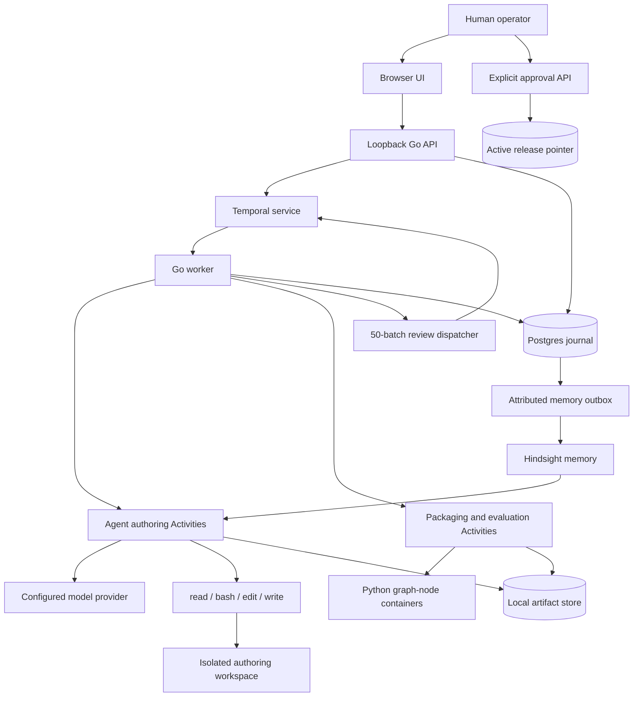
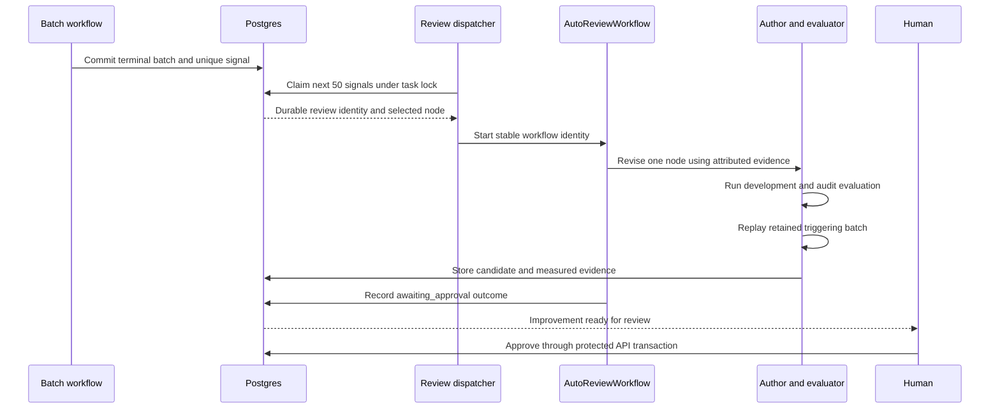

# AfterThought Technical Design Document

## 1. Purpose and baseline

AfterThought reduces repeated data-science work by having an agent author an executable graph, evaluate it, retain learning evidence, and propose targeted revisions. The first workload is insurance-fraud screening. Each input row produces a probability, an `accept`, `escalate`, or `reject` recommendation, and reasons for human review.

This document describes the current hackathon implementation, including cumulative learning, fixed backtests, policy-aware review, and the frontend demo controllers. The architectural decisions preserve the requested empty initial domain library, four-tool harness, Go/Temporal orchestration, Hindsight memory, and explicit human activation.

The demonstration establishes executable graph reuse, measured evaluation, and controlled robustness improvement. Establishing fraud accuracy requires the team's verified labels, documented target semantics, and a suitable independent evaluation dataset.

## 2. Requirements and acceptance criteria

| Requirement | Design and acceptance evidence |
| --- | --- |
| Bootstrap from a CSV | Operator supplies a binary target, positive label, feature selection, label provenance, and evaluation policy. The agent authors fit and serve DAGs from an empty domain library. |
| Reuse learned computation | An approved graph processes a complete serving CSV through Python nodes. Serving-model calls and input/output tokens remain zero. |
| Tune individual building blocks | A revision targets `fit:ID` or `serve:ID`. Packaging validates every protected node revision and the graph topology against the parent. |
| Learn from additional datasets | Compatible training/development partitions accumulate for fit-node tuning. Original development/audit gates stay fixed, and separate backtests measure each version. |
| Evaluate before activation | Trusted evaluation computes held-out metrics. Eligible revisions also meet the incumbent development F1. Automatic repairs successfully replay their triggering batch. |
| Retain learning | Source-attributed observations, development measurements, review outcomes, and human decisions enter the durable memory outbox. |
| Review automatically | An opted-in scope consumes windows of 50 finished batches for its active release. An attributable failure can create a repair; a fresh numerical departure can create a policy proposal. Manual review uses the same gates. |
| Require human activation | Every activation requires reviewer identity, an explicit operator decision, and an expected-current-release check. The local frontend uses same-origin approval clicks. |
| Recover safely | Temporal histories, request digests, tool journals, immutable artifacts, and committed node outputs support replay and retry. |

## 3. System architecture



The Go worker owns orchestration Activities and host-side container execution. Temporal stores execution histories. Postgres stores application state and admission identities. Content-addressed local files hold datasets, transcripts, source packages, fitted state, and outputs. Hindsight supplies recall during authoring.

| Component | Responsibility | Location |
| --- | --- | --- |
| CLI and demo host | Configuration, service startup, worker registration, static UI hosting | `cmd/afterthought/` |
| HTTP API | Dataset intake, build admission, release inspection, approval, batch submission, review settings | `internal/webapi/` |
| Agent harness | Four tools, workspace boundaries, lazy skill discovery | `internal/harness/` |
| Durable authoring | Setup, model turns, serial tool execution, finalization | `internal/runtime/` |
| Model transport | Responses and Chat Completions adapters, transcript continuity, usage | `internal/model/` |
| Dataset service | CSV validation, immutable splits, prediction validation, metrics | `internal/dataset/` |
| Pipeline service | Bootstrap, tuning, evaluation, approval, batch lifecycle, automatic review | `internal/pipeline/` |
| Graph interpreter | Versioned executable DAGs, pinned packages, container execution | `internal/execution/` |
| Persistence and memory | Artifact integrity, journals, memory delivery and provenance | `internal/storage/`, `internal/memory/` |
| Browser application | Graph inspection, source/configuration, evaluation, approval and review controls | `frontend/` |

The executable manifest version is `v2`. Legacy `v1` validation remains available through the CLI. The standalone claims replay uses illustrative browser rules and has its own implementation. [Architecture overview](architecture.md)

## 4. Dataset and node contracts

### Dataset intake

The operator supplies a headered CSV and metadata containing the learning scope, target column, positive label, label meaning, permitted feature columns, synthetic-data flag, provenance confirmation, and precision/recall/false-positive-rate thresholds.

Intake requires at least 50 labelled rows and at least 10 rows in each of exactly two classes. The supported limits are 64 MiB, 100,000 rows, 128 source columns, 64 selected features, and 16 KiB per cell. Serialized dataset artifacts also have a 64 MiB limit.

The service infers number, boolean, string, and nullable feature values. It retains deterministic, class-stratified splits of approximately 60% training, 20% development, and 20% audit. Dataset identity binds the source and declared evaluation configuration. Authoring receives labelled training/development files and aggregate profile metadata. The supervisor retains audit data outside the author workspace.

An `evaluation_only` dataset places its entire sample in audit storage and cannot be used for bootstrap or feedback. Learning datasets must share the task, target, positive label, synthetic flag, confirmed provenance, feature order, and inferred types. Builds accept up to eight feedback datasets and four backtests. Additional feedback requires a fit-node revision. Learning validation rejects duplicate feature vectors across training/development inputs and overlap with reserved audit rows.

Serving CSVs are checked against the frozen feature contract. The prepared serving artifact contains feature objects and stable row IDs. Labels are omitted from that artifact. Entity-based and chronological split policies are follow-on design work. [Dataset implementation](../internal/dataset/csv.go)

### Graph manifest

The agent writes `candidate.json` with `version`, `name`, `fit`, and `serve`. Each graph declares its nodes and output node. Each node declares a stable ID, source file, dependencies, input bindings, JSON configuration, timeout, and attempt limit.

The fit graph has at least one node. The serve graph has at least two connected nodes. Each graph supports at most 16 nodes. Input ports bind to `$input`, declared predecessors, or `$fit` in a serving graph.

Every Python node exposes the same function signature.

```python
def run(inputs, config):
    # inputs contains decoded JSON values by declared port name.
    # Return a JSON-serializable result for downstream nodes.
    ...
```

Nodes are self-contained modules. The generic environment supplies Python, NumPy, pandas, scikit-learn, and joblib. Fitted preprocessing and model state travel through the fit output artifact. The author chooses the actual feature transformations and model implementation.

The final serving node returns this output shape.

```json
{
  "predictions": [
    {
      "row_id": "row-identifier",
      "probability": 0.72,
      "decision": "escalate",
      "reasons": ["A reason grounded in the node's input and computation"]
    }
  ]
}
```

Validation requires one prediction for every input row, matching row identities, finite probabilities in `[0, 1]`, a supported decision, and nonempty reasons. Business-quality assessment of those reasons remains part of human evaluation. [Graph contracts](../internal/execution/graph.go) · [Prediction evaluation](../internal/dataset/evaluate.go)

## 5. Bootstrap and evaluation lifecycle

1. **Admit the build.** Persist the request ID and normalized input digest before starting Temporal. An identical retry reuses its identity. Conflicting input under the same ID fails admission.
2. **Prepare authoring.** Stage permitted data, a lazy graph-authoring contract, skill metadata, and attributed memory in a scoped workspace.
3. **Author the graph.** `AgentWorkflow` invokes the configured model and executes `read`, `bash`, `edit`, and `write` serially. Skill bodies load through `read` when requested.
4. **Package the candidate.** Validate topology and bindings, snapshot source/wrapper artifacts, canonicalize configuration, and pin the resolved runtime image. Derive node revisions and graph identity.
5. **Fit and execute.** Run the fit graph on training data. Run the serve graph on development and audit inputs using the fitted artifact.
6. **Evaluate centrally.** Compare probabilities with retained labels and the frozen threshold. Compute confusion counts, precision, recall, F1, false-positive rate, accuracy, and majority baseline. Enforce the frozen policy on both splits.
7. **Retain the candidate.** Store reports and execution traces. Passing candidates receive `eligible` status. The UI exposes the candidate for a human release decision.

A normal build permits two authoring attempts when packaging needs correction. Each attempt runs its own bounded authoring session. The bootstrap API defaults to 20 turns and permits 1–32. Automatic review uses the tighter limits in section 8.

Packaged graphs that fail execution remain inspectable with `execution_failed` status. Successfully evaluated candidates carry `eligible` or `rejected` status. Approval metadata and the active channel pointer record activation independently of candidate status. [Pipeline orchestration](../internal/pipeline/workflow.go)

## 6. Human activation and serving

### Approval transaction

The approval endpoint validates an explicit decision, a reviewer name, evaluation eligibility, and the expected active release. Code-free browser decisions require the exact same loopback origin. Keyed host clients remain supported. Automatic candidates also require a passed regression report.

A transaction locks the candidate, serializes channel updates by learning scope, records an approval event, and updates `graph_channels`. Concurrent approvals using a stale expected pointer fail. The key lives in ignored host state outside agent and node mounts. Approval is available to the human-facing API and has no model-tool or Activity registration.

The local frontend accepts the operator's explicit click and supplied reviewer name through the same-origin API. Host clients can instead supply the approval key. Authenticated operator identity is a prerequisite for a shared deployment. [Approval implementation](../internal/pipeline/store.go)

### Serving lifecycle

Batch admission pins an approved release and a retained input artifact. The API accepts an explicitly selected approved release, including a previously approved release. The active channel identifies the current default and automatic-review scope.

`BatchWorkflow` resolves the pinned serve graph and fitted artifact. `GraphWorkflow` traverses nodes in deterministic topological order, scheduling one Activity per node for the whole batch. Execution is sequential within a graph. A failed node stops its descendants. The final Activity validates outputs, stores batch state, and records aggregate review signals atomically.

The graph executes with zero serving-model calls and zero serving-model tokens. It uses numerical computation, container runtime, and storage resources. Authoring and memory services have their own model usage.

## 7. Node-level evolution

A manual tuning request identifies a parent release and exactly one `fit:ID` or `serve:ID`. Authoring receives the incumbent manifest, node sources, fitted-state references where applicable, and development evidence.

The packager permits edits to the selected node's source or configuration. It validates the protected revisions, graph name, output IDs, topology, input bindings, node IDs, timeouts, and attempt limits against the parent. A serving-node revision reuses the fitted artifact. A fit-node revision retrains before evaluation.

The supervisor reruns development and audit evaluation. Development F1 must meet the incumbent value within the implemented numerical tolerance. A newly eligible candidate goes through the same human approval transaction. This supports improvements through inspectable node revisions and measured evidence. [Tuning validation](../internal/execution/graph.go) · [Authoring preparation](../internal/pipeline/authoring.go)

### Repeated-learning lifecycle

1. The frontend uploads an initial dataset, three supplemental datasets, and one evaluation-only benchmark from the local prepared bundle.
2. The initial build pins `backtest_dataset_ids` and authors a graph with one fit node and at least two serving nodes. Guided learning requests a 24-turn authoring budget.
3. Each next round tunes the preceding candidate's fit node and carries cumulative `feedback_dataset_ids`. Prior feedback IDs must remain present. The supervisor stages merged `data/train.json`, `data/development.json`, `data/original-development.json`, and `learning.json` provenance.
4. The actual fit graph retrains on cumulative training rows. The frozen serving graph is evaluated against original development/audit data and each retained backtest's audit partition.
5. Original development/audit gates determine eligibility, including development-F1 nonregression against the parent. Backtest reports supply comparative measurements. A completed rejected candidate can be tuned again; a terminal failed build stops the guided sequence.
6. The operator inspects each version and explicitly approves an eligible candidate for serving.

The supplied bundle starts with 400 cases, split into 240 training, 80 development, and 80 audit rows. Cumulative training grows to 600, 716, and 800. The separate benchmark contains 560 cases with equal fraud/legitimate labels. The main chart uses benchmark accuracy; **Original audit accuracy** uses the same 80 original audit cases in every round. Additional audit partitions remain withheld from learning. Preparation fixes the data sequence, while actual model authoring and graph execution produce the revisions and scores.

Benchmark labels/results and original audit evidence remain outside the authoring workspace and improvement memory. Recorded development measurements can guide later work. Repeated operator selection using benchmark results consumes its independence. [Learning data validation](../internal/dataset/learning.go) · [Frontend controller](../frontend/src/learning-demo.mjs)

## 8. Automatic robustness review

### Trigger policy

Auto-review is opt-in per learning scope. A transition from disabled to enabled starts a fresh sequence baseline. Repeating `enabled=true` preserves the counter. One admitted serving CSV contributes one finished batch when it completes or fails. Activity retries retain the same batch identity.

The worker maintenance loop checks approximately every 15 seconds. A transaction acquires a task advisory lock, selects the next 50 signals for the active release after the cursor, and consumes that window once. The same lock coordinates signal insertion and window consumption, preventing a late commit from falling behind the consumed cursor.

Training, evaluation, and benchmark backtests do not create these serving-batch signals. The prepared repeated-learning sequence can run before activation. **Review now** claims 1–50 available serving signals with the same cooldown and pending-proposal checks. The guided policy demo uses this immediate-review path after its two demonstration batches.

Signals include row count, missing-value counts, a fixed failure kind, an attributable node ID, and aggregate numerical departures from frozen training ranges. A failed graph's retained progress query supplies the failed node when its child result is unavailable. Invalid final predictions identify the serving output node. Aggregate diagnostics feed the review prompt while the triggering input stays in supervisor storage.

A window with an attributable execution/output failure selects the most recent applicable failed serving node. Without an attributable failure, fresh numerical novelty selects the policy-review path described below; otherwise the window records `no_action`. Missing-value counts provide supporting diagnostics. Verified feedback remains available through memory and manual tuning.

### Repair workflow



| Control | Current value |
| --- | --- |
| Review window | 50 completed or failed batches |
| Authoring attempts | One per automatic proposal |
| Model-turn budget | 12 |
| Cooldown | 10 minutes from repair claim |
| Pending automatic proposals | One per parent release |
| Review workflow execution timeout | 30 minutes |
| Child build execution timeout | 20 minutes |

A healthy window leaves the authoring-model budget unused. Repair eligibility requires frozen evaluation gates, development F1 preservation, a changed selected node, and a successful replay of the triggering batch. Replay validates completion and output shape for that input. Additional labelled examples are required to evaluate prediction accuracy on the repaired condition.

Review states are `no_action`, `queued`, `running`, `cancelled`, `failed`, `rejected`, `awaiting_approval`, and `approved`. Preparation cancels queued work when the scope is disabled or its active parent changes. Already-running authoring can finish. Dispatcher reconciliation uses Temporal status and the durable build journal to recover terminal outcomes after interrupted cleanup or history expiry.

At a sustained completion rate of `r` batches per minute, the collection time is approximately `50 / r` minutes. The UI estimates remaining collection time from observed completion intervals. Dispatch delay, cooldown, authoring, evaluation, and human review add to activation time. [Review implementation](../internal/pipeline/review.go)

## 9. Persistence and identities

| Record | Durable content and identity |
| --- | --- |
| `agent_datasets` | Immutable metadata, feature contract, policy and split references |
| `graph_builds` | Build request ID, input digest, phase, author session, candidate, feedback and backtest IDs |
| `graph_releases` | Graph, fitted artifact, parent, changed node, original evaluations, backtest reports, feedback IDs and approval metadata |
| `graph_channels` | Current release pointer per scope |
| `graph_approvals` | Reviewer, selected release, previous release and timestamp |
| `graph_batches` | Request identity, pinned release/input, output, trace and zero-model counters |
| `graph_review_settings` | Opt-in state, consumed sequence cursor and cooldown |
| `graph_batch_signals` | Monotonic sequence and a unique signal per batch |
| `graph_auto_reviews` | Review identity, immutable build request, status and candidate |
| Agent journals | Sessions, model usage, transcripts and tool-call intent/results |
| `agent_memory` | Attributed source events, deduplication keys and Hindsight delivery receipts |

Artifact references contain a SHA-256 digest and size. Package and invocation identities include pinned execution inputs. Committed-winner records allow repeated node Activities to reuse published output. Automatic candidate identities also bind the review ID, preserving that proposal's provenance.

Internal child workflow/session names and automatic-review request IDs are reserved at public admission boundaries. Postgres and `.afterthought/` together hold the application state needed to resolve retained histories. [Pipeline storage](../internal/pipeline/store.go) · [Artifact storage](../internal/storage/files.go)

## 10. Memory and inference cost

Hindsight uses a task-derived bank and task tags for recall. Authoring combines recent authoritative journal records with retrieved observations and their source facts. Human feedback, execution measurements, and model-authored summaries retain their attribution.

Source events first enter Postgres with a deduplication key. Delivery uses stable Hindsight document/operation identities. The outbox records acceptance and can retry failed delivery. Hindsight processing completes asynchronously. A configured recall failure surfaces during authoring. Explicit local-memory mode supports offline development.

Automatic review records its trigger, candidate outcome, replay result, development F1, and attributed human approval. Audit results stay in supervisor/operator evidence. The next authoring session can use retained failures and successful repairs as context.

The cost model includes initial authoring, repair authoring, memory extraction/embeddings/reflection, graph computation, and infrastructure. The zero-token property applies to graph serving. Authoring usage counters and Hindsight provider usage require separate accounting. [Memory adapter](../internal/memory/hindsight.go) · [Memory outbox](../internal/storage/postgres.go)

## 11. API and UI contracts

| Endpoint | Purpose |
| --- | --- |
| `GET /api/learning-demo` | Read the prepared local learning bundle; returns 404 when missing |
| `POST /api/datasets` | Upload CSV plus dataset options as multipart data |
| `GET /api/datasets` and `GET /api/datasets/{id}` | List and inspect frozen datasets |
| `POST /api/bootstraps` | Admit an authoring/evaluation request with stable ID |
| `GET /api/bootstraps?task=...` | Restore build history for a learning scope |
| `GET /api/bootstraps/{id}` | Inspect build phase, error, session and release |
| `GET /api/releases` and `GET /api/releases/{id}` | Inspect candidates and the active pointer |
| `GET /api/releases/{id}/nodes/{phase}/{node}` | Inspect pinned node source and configuration |
| `POST /api/releases/{id}/tune` | Request a selected-node revision |
| `POST /api/releases/{id}/approve` | Record explicit human approval and activate |
| `POST /api/releases/{id}/runs` | Upload a CSV for an approved release |
| `GET /api/graph-runs/{id}` | Inspect batch status, trace and bounded output preview |
| `GET /api/graph-runs/{id}/output` | Download retained predictions |
| `GET /api/auto-review?task=...` | Read settings, counter, ETA and latest review |
| `PUT /api/auto-review` | Set an explicit `enabled` boolean for a task |
| `POST /api/auto-review/run` | Manually review available evidence with existing gates |
| `GET/POST /api/policies` | Read current knowledge or upload a searchable PDF |
| `GET /api/policies/{id}/source` and `/text` | Download original PDF or complete versioned text |
| `POST /api/auto-reviews/{id}/draft` | Resume a review after its policy is supplied |
| `GET /api/policy-proposals/{id}` | Inspect the draft and pinned policy evidence |
| `POST /api/policy-proposals/{id}/decision` | Record human approval or dismissal |

The Graph Runtime page presents dataset intake, bootstrap jobs, versioned DAGs, node inspection, evaluation, approval, batch results, and automatic review. The candidate inspection action opens replay evidence and before/after F1. The existing approval form performs activation.

The guided page offers **Repeated learning · your claims CSVs** and **Policy review · synthetic claims**. **Demo options → Show technical workspace** exposes manual controls. Repeated learning presents selectable version bars, metrics, a full results table, the recorded public explanation, model/tool activity, and changed-node source/configuration. Activity DTOs exclude system/developer messages and opaque provider reasoning items.

Browser progress stores stable task/build identities. Polling runs about every 3.5 seconds while visible. Refresh restores state; learning task URLs also support reconstruction from retained jobs and datasets. Temporal runs admitted jobs while the page is closed. The browser submits subsequent guided steps when it resumes. Starting another demo retains earlier server evidence in its previous scope.

The API uses same-origin browser access and loopback host restrictions. JSON mutations enforce bounded strict decoding. CSV endpoints use bounded multipart uploads. Read responses expose operation state so clients can retry asynchronous admission using stable IDs. [HTTP implementation](../internal/webapi/pipeline.go) · [Graph UI](../frontend/src/graphs.mjs)

## 12. Durability and failure handling

| Failure | Implemented behavior |
| --- | --- |
| Lost admission response | Input digest and workflow identity allow an identical request retry. |
| Worker restart | Temporal replays recorded commands and completed Activity results. |
| Uncertain shell-tool outcome | The journal reports uncertainty so the agent can inspect state before choosing another action. |
| Node completes before acknowledgement is lost | Committed output is available under the same invocation identity. |
| Node timeout or invalid output | Batch failure and aggregate signal are retained. Descendant execution stops after node failure. |
| Duplicate batch completion | Atomic terminal-state/signal handling preserves a single counted completion. |
| Review dispatch loses its start acknowledgement | Stable workflow identity and duplicate rejection preserve the claimed proposal. |
| Review cleanup is interrupted | Dispatcher reconciles retained workflow/build status. |
| Hindsight delivery fails | The source event remains in the durable outbox for retry. |
| Concurrent human activation | Expected-current comparison and task serialization reject stale approval. |

Model-turn and tool Activities use one automatic execution attempt to bound duplicate provider spend and uncertain effects. Temporal durability still depends on retained histories, application journals, artifacts, and available pinned images. External side effects authored inside a tool require their own idempotency design. [Agent orchestration](../internal/runtime/agent.go) · [Node execution](../internal/execution/engine.go)

## 13. Isolation and local operation

The demo runs on one trusted host with Go 1.25+, Docker/Colima, and Docker Compose. `make demo` starts Postgres, Temporal, Hindsight, the generic ML image, and the UI/API/worker. A separate worker is supported through `serve --with-worker=false`. The default worker permits four concurrent Activities. Compose pins Postgres 17.6, the Temporal CLI development server image 1.4.1, and Hindsight 1.2.0. The configured authoring default is `gpt-6.1-sol` through the Responses adapter. Hindsight has a separate model setting and embedding configuration.

Graph containers use a pinned image, read-only package/input mounts, disabled networking, dropped capabilities, a non-root UID, one CPU, 768 MiB memory, a 128-process limit, and bounded temporary/output storage. Node timeouts support 1–300 seconds and 1–3 attempts. Bash authoring containers have workspace access, read-only skills, bounded output, and networking disabled by default.

Provider credentials and the host approval key remain outside sandbox mounts. Filesystem tools enforce scoped paths and regular-file checks. Operational policy should keep personal identifiers out of author-visible data and model transcripts. The current tool interface can read permitted workspace content, so field selection and data preparation remain important controls.

Preserve `.afterthought/` and the Postgres, Temporal, and Hindsight volumes together. Pinned Docker images must remain available for replayed execution. Runtime configuration comes from `.env` and exported variables. `.env`, generated binaries, datasets, and session state remain ignored by Git. [Local setup](../README.md#run-locally) · [Service topology](../compose.yaml)

## 14. Validation and demonstration

Run `make test` for Go race tests and Node tests. Run `make integration` with the local services and runtime images available. Integration fixtures use mock model/memory endpoints where appropriate and real Postgres, Temporal, and Docker execution. Run `go vet ./...` and the Temporal workflow determinism checker for orchestration changes.

The automatic-review regression exercises a synthetic labelled graph, a real null-handling node failure, an authored one-node fix, frozen evaluation, retained-batch replay, fixture-human approval, and successful zero-model serving. Counter tests exercise 49/50 boundaries, healthy windows, retries, concurrent completion/claim, cooldown, pending proposals, and release scoping. History replay tests cover ordinary builds, failed batches, automatic review, and repaired serving. Fixture completion events accelerate counter setup.

A live demo follows the same observable stages. Bootstrap a synthetic graph, inspect its metrics, approve it, enable Auto-review, collect 50 finished batches including an attributable robustness failure, inspect the proposed repair, approve it, and rerun the failed input. The authoring-model result in a live demo remains dependent on the chosen model and available evidence. [Review tests](../internal/pipeline/review_test.go) · [Demo walkthrough](demo.md)

## 15. Design limitations and follow-on decisions

| Area | Current constraint | Follow-on decision |
| --- | --- | --- |
| Fraud ground truth | Operators declare and confirm label provenance. | Define verified outcomes, label arrival delay, leakage controls and the investigator review process with the dataset owner. |
| General workload support | Executable intake handles binary tabular CSV classification. | Specify contracts and metrics for other target types and automatic dataset discovery. |
| Improvement signals | Automatic proposals use attributable execution/output failures or bounded numerical novelty. | Add verified-correction triggers, drift diagnostics and fresh labelled evaluation windows. |
| Approval lifecycle | The UI supports graph activation, policy approval/dismissal, and automatic/manual review. | Add graph-candidate dismissal and resuming graph proposals after rejection. |
| Audit independence | Candidates repeatedly reuse a frozen audit split. | Define final-audit rotation and entity/time-based validation before making independent accuracy claims. |
| Graph scheduling | Nodes run sequentially in topological order. | Measure container startup and node latency before introducing parallel scheduling or reusable executors. |
| Recovery and deployment | Artifacts and runtime images reside on a local host. | Specify object storage, image distribution, backup restoration and multi-worker ownership. |
| Shared operation | Access assumes a trusted local operator. | Add authenticated identity, tenant isolation, authorization and stronger execution isolation before shared deployment. |
| Cost and performance | Provider usage and node durations are observable. | Benchmark representative datasets and set latency, throughput, repair-success and spend targets. |

These extensions preserve human-controlled activation, immutable release evidence, minimal model-visible tools, and measured evaluation as the basis for accepting graph revisions.


## Policy knowledge and emerging-pattern review

Searchable PDF uploads become append-only documents scoped to a task. Extraction uses bounded Poppler execution (8 MiB input, 30 pages, 128 KiB text, 20 seconds). Graph authoring pins a document ID and stages its numbered pages in `knowledge/company-policy.json`. Documents are reference data; the four-tool and human-approval boundaries remain unchanged.

Batch completion compares numeric features against frozen **training** ranges, without LLM or memory calls. A signal requires at least ten training observations and at least three affected rows representing 10% of the batch, beyond a margin of max(25% of the training range, 1% of absolute maximum, 0.01). Missing values, categorical novelty, correlations, and label-based fraud accuracy are not evaluated by this detector. It emits feature/range/count aggregates, not source records.

Runtime failures with an attributable node take priority and retain the existing one-node repair/evaluation/replay workflow. Otherwise fresh numeric departures queue `PolicyReviewWorkflow`; missing policy pauses at `needs_policy`. `Review now` consumes 1–50 available batches through the same lock, cursor, cooldown and pending-review gates. Automatic review still requires 50.

A policy review uses the existing durable agent and Hindsight recall, up to 12 turns, to produce `policy-proposal.json`. Collection validates bounded fields, exact whitespace-normalized page quotations, and observed evidence IDs. The UI separates the hypothesis, alternative explanations, and proposed investigator procedure. Model text is not verified truth.

Approval or dismissal requires a reviewer identity, explicit confirmation, assessment, and note. The frontend uses a same-origin operator click; keyed host clients remain supported. Publishing checks the current policy ID, appends the amendment, and records attributed feedback in the memory outbox. In the guided policy demo, the browser subsequently requests a serving-output-node revision. Evaluation and a separate human graph approval precede activation. Reviewed dataset/feature/direction signatures are suppressed for the current policy version. Statistical-accuracy claims require verified labels and suitable evaluation.
